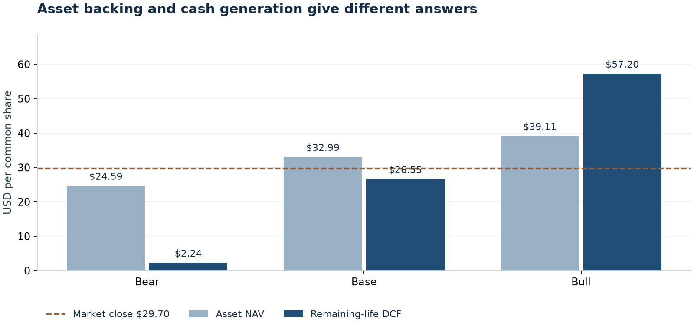

# Shipping equity research

**Fleet value, finite-life cash flow and market-implied freight rates.**

Shipping equities can look inexpensive against vessel values while requiring demanding
future earnings. This project makes that comparison inspectable: start with individual
ships, follow their remaining cash flows, then solve the freight-rate assumption embedded
in the share price.

The research now covers **Star Bulk (SBLK)** and **Genco Shipping & Trading (GNK)**. GNK's
12 October 2026 base scenario produces **$27.15/share asset NAV** and **$19.23/share DCF**,
against a **$26.67 close**. SBLK's 9 October snapshot remains **$32.99 NAV** and **$26.55
DCF** against **$29.70**. These are conditional estimates, not price targets or recommendations.

[Open the Excel model](outputs/sblk-2026-10-09/SBLK-valuation.xlsx) ·
[Read the executed notebook](notebooks/SBLK-research.ipynb) ·
[Open the GNK model](outputs/gnk-2026-10-12/GNK-valuation.xlsx) ·
[Read the GNK notebook](notebooks/GNK-research.ipynb) ·
[Peer comparison](docs/PEER_COMPARISON.md) ·
[Star Bulk vs Genco test](docs/PAIR_ANALYSIS.md) ·
[Research note](docs/RESEARCH_NOTE.md) ·
[Five-minute guide](docs/QUICK_START.md)



## What the first release does

| Question | Model output |
| --- | --- |
| What is the fleet worth? | Vessel-level appraisals, remaining commitments and a common-equity NAV bridge. |
| What cash can it generate? | Twelve quarterly periods, annual fleet runoff, working capital, delivery payments and financing. |
| What rates justify the price? | A common open-rate multiplier, solved and repriced through the complete DCF. |
| What changes the conclusion? | Three coherent scenarios, freight/discount sensitivities and targeted notebook stresses. |
| Can the calculations be checked? | Independent Excel and Python implementations, source reconciliations and synthetic arithmetic tests. |

The SBLK register includes **135 operating vessels and three committed newbuilds**; GNK has
a separate **44-vessel** package. Each workbook agrees with Python on **3,657 compared
values** across all scenarios. GNK's maximum absolute difference is below **$0.000001**.
[Calculation evidence](outputs/sblk-2026-10-09/reconciliation.json) and
[verification details](docs/VERIFICATION.md) define the checks and their limits.

## Star Bulk vs Genco: like-for-like test

At the 23 October 2026 close, Genco looks dearer than Star Bulk on the flat base vector
(13.8% vs 4.3% open-rate uplift needed). Most of that gap is fleet mix: Genco is 71%
Capesize/Newcastlemax by deadweight against 45%. Reshaped to the Cal-27 FFA curve, the prices
imply 0.94x and 0.93x of it. A Cal-27 FFA overlay neutralises the mix. About 7% of residual
value gap remains, and NAV parity and a common curve multiple agree on that size.
[The like-for-like test](docs/PAIR_ANALYSIS.md) has the tables, the overlay sizing and the limits.

## Run it locally

Requires Python 3.11+ and [uv](https://docs.astral.sh/uv/). From the repository root:

```bash
uv sync --frozen --extra dev
uv run shipping-equity list
uv run shipping-equity validate SBLK
uv run shipping-equity run SBLK
uv run shipping-equity validate GNK
uv run shipping-equity run GNK
uv run shipping-equity reconcile SBLK --evidence outputs/sblk-2026-10-09/excel-calculation-evidence.json
uv run shipping-equity reconcile GNK --evidence outputs/gnk-2026-10-12/excel-calculation-evidence.json
uv run python scripts/build_company_notebook.py GNK
uv run pytest -q
```

Open `outputs/sblk-2026-10-09/report.html` in a browser for the local reading view.
The report, charts and CSVs regenerate offline from the committed inputs. GitHub displays
the notebook and README; download or clone the repository to open the HTML report locally.

The supplied Excel file is formula-driven. Change **Assumptions D5** to select Bear (1),
Base (2) or Bull (3); **D6** changes open charter rates and **D7** adjusts the discount rate.
Excel edits do not automatically update Python files or the saved report.
See the [workbook guide](docs/QUICK_START.md#using-excel) for the full reading order.

## Add another stock

Each company has its own six-file package under `data/companies/`. No ticker-specific
valuation equations are embedded in the Python engine.

```bash
uv run shipping-equity init-company SB --name "Safe Bulkers" --date 2026-10-12
# Fill the blank templates with reviewed, dated SB inputs before running:
uv run shipping-equity validate SB
uv run shipping-equity run SB
```

The scaffold intentionally contains missing values. It never fills a new company with
another company's facts. Follow [Adding companies](docs/ADDING_COMPANIES.md) for field definitions,
source requirements and validation. The current economics support **dry bulk**; other
shipping segments need a reviewed extension. Safe Bulkers remains a future research case.

## How it is organized

```text
data/companies/       Reviewed company facts, fleet, sources and assumptions
data/templates/       Blank inputs for the next company
src/shipping_equity/  Loading, fleet calendar, valuation, reconciliation and reporting
scripts/              Workbook authoring and executed-notebook generation
notebooks/            Research walkthrough with calculated outputs
outputs/              Dated workbook, report, charts, schedules and verification evidence
tests/fixtures/       Clearly separated synthetic company
docs/                 Research note, methodology, source audit and extension guide
```

Read [Methodology](docs/METHODOLOGY.md) for the equations and
[Source audit](docs/SOURCE_AUDIT.md) for the appraisal mismatch, date bridges and estimates.
The Excel authoring script uses `@oai/artifact-tool`, supplied by the Codex spreadsheet
runtime; it is a separate dependency from the portable Python workflow.
[Rebuilding Excel](docs/QUICK_START.md#rebuilding-the-workbook) explains that boundary.

## Research boundaries

This is a public-input snapshot with manually reviewed data, not an automated market-data
feed. Freight rates are explicit scenarios; the like-for-like test uses secondary-source Cal-27 FFA
levels, not a licensed curve. There is no reconstructed
charter book, full survey calendar, fleet-renewal financing model or historical forecast
validation. The peer comparison is not yet normalized to a common reporting date. A passing arithmetic check does not validate an
investment thesis. See [release status](docs/BUILD_STATUS.md) for completed and deferred work.
