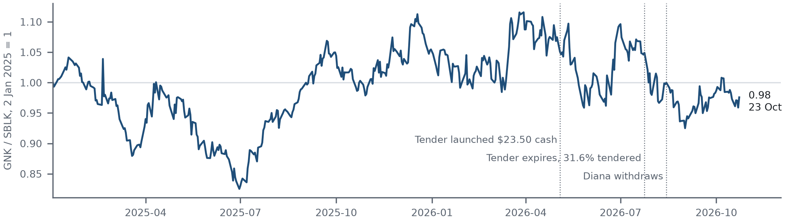

# Pair analysis: long SBLK, short GNK

**Prices at the 23 October 2026 close. Model inputs are unchanged from the dated SBLK (9 October)
and GNK (12 October) packages; only the share price is refreshed.**

The question is whether Genco is expensive relative to Star Bulk once each company's
fleet mix is accounted for, and what a freight-neutral pair would still be exposed to.

## The obvious comparison misleads

| Base-case measure | Star Bulk | Genco |
| --- | ---: | ---: |
| Share price, 23 Oct 2026 | $28.98 | $25.63 |
| Price / asset NAV | 0.88x | 0.94x |
| Open-rate uplift to match price (flat base vector) | 4.3% | 13.8% |
| Capesize + Newcastlemax share of deadweight | 45% | 71% |
| Price as a multiple of a Cal-27 curve-shaped vector | 0.93 | 0.94 |

On the flat base vector, Genco needs much higher freight rates than Star Bulk. Cal-27 FFAs on
15 October 2026 (Capesize $31.3k, Panamax $16.8k, Supramax $15.7k/day) sit 30% above the base
Capesize rate. Once the vector is reshaped to that curve, the two prices imply almost the
same share of it. Most of the apparent gap is fleet mix, so an unhedged GNK short is largely a
short in Capesize rates.

## FFA overlay and what remains

| Per USD 10m each leg, value change for +10% rates | Capesize | Panamax | Supramax |
| --- | ---: | ---: | ---: |
| Long SBLK | +$0.79m | +$0.59m | +$0.82m |
| Short GNK | -$1.30m | $0.00m | -$0.87m |
| Net pair | -$0.51m | +$0.59m | -$0.05m |
| Cal-27 FFA days to neutralise | buy 164 | sell 350 | buy 35 |

The overlay is sized to a parallel, permanent move in each bucket, with undiscounted FFA P&L.
It is a design, not a traded or backtested hedge. After the overlay, two measures agree on
the size of the residual. NAV parity is worth +7.9% to the pair. At a common curve multiple,
SBLK is worth $29.97 (+3.4%) and GNK $24.76 (-3.4%).

| Asset NAV return vs price | Bear | Base | Bull |
| --- | ---: | ---: | ---: |
| Star Bulk | -15.2% | +13.8% | +34.9% |
| Genco | -18.1% | +5.9% | +24.7% |
| Pair | +3.0% | +7.9% | +10.3% |



Price statistics (weekly, three years): correlation 0.85; GNK-on-SBLK beta 0.86; residual
volatility 17.7%; worst drawdown of the unhedged dollar-neutral spread -35%. All values are in
[`pair_results.json`](../outputs/pair-sblk-gnk-2026-10-23/pair_results.json).

## Reproduce

```bash
uv run --with yfinance python scripts/pair_fetch_prices.py   # vendor prices -> .cache/ (not committed)
uv run python scripts/pair_analytics.py --asof 2026-10-23
uv run python scripts/pair_figure.py --asof 2026-10-23
```

## Limits

- The Cal-27 FFA levels come from a secondary source citing Baltic Exchange data, not a
  licensed curve. Holding the curve shape flat over ship lives is a stress view, not a forecast.
- NAV marks are dated. Genco's fleet value is inferred from a rounded loan-to-value disclosure. A
  5% error in either company's marks moves NAV by about 6.5% of the share price, which is
  comparable to the whole residual.
- Company earnings differ from FFA indices (Newcastlemax and scrubber premia). SBLK's 97%
  scrubber-fitted fleet carries fuel-spread exposure that the overlay does not hedge.
- Price statistics use vendor-adjusted closes and are for reference only.
- These are conditional estimates, not recommendations.
